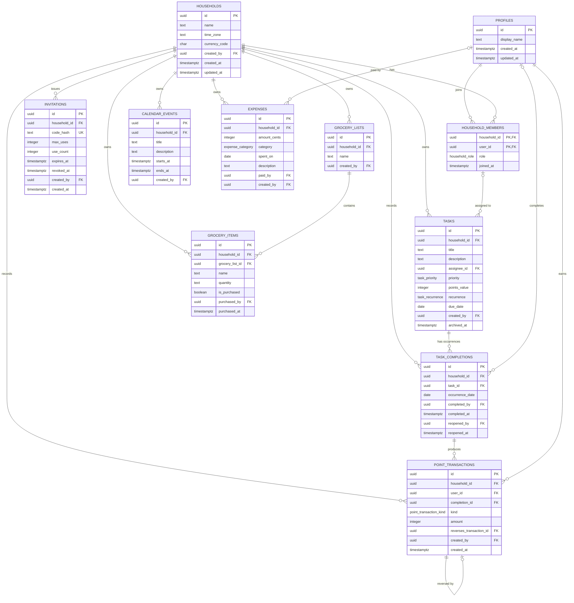

# HomeBase Database Design

> **Status: planned.** No migrations exist yet. This document defines the schema the team will implement with Supabase PostgreSQL. Column names, constraints, and function names here are the intended design.

## 1. Conventions

| Topic                  | Convention                                                                                                                                                                   |
| ---------------------- | ---------------------------------------------------------------------------------------------------------------------------------------------------------------------------- |
| Naming                 | `snake_case` for tables, columns, indexes, and functions. Tables are plural nouns.                                                                                           |
| Primary keys           | `uuid`, generated with `gen_random_uuid()`, unless the table's key is a composite of foreign keys.                                                                           |
| Timestamps             | `timestamptz`, stored in UTC. Created and updated timestamps use `now()`.                                                                                                    |
| Calendar dates         | `date`, interpreted in the household's time zone. Used for due dates and occurrences.                                                                                        |
| Money                  | `integer` cents (`amount_cents`). Floating-point types are not used for money.                                                                                               |
| Enumerations           | PostgreSQL `enum` types, listed in section 3.                                                                                                                                |
| Household scope        | Every household-owned table has a `household_id` column, even when it could be inferred through a join. The column makes RLS policies, indexes, and Realtime filters simple. |
| Composite foreign keys | Used where a row must belong to the same household as the row it references (for example, `tasks.assignee_id`).                                                              |
| Text limits            | Length limits are enforced in the database with `CHECK` constraints and in the API with validation. The API message is shown first; the database is the backstop.            |
| Updated timestamps     | A shared trigger sets `updated_at` on every update.                                                                                                                          |

## 2. Entity relationship diagram



The diagram shows the main columns only. Section 4 lists every column, and composite keys appear in the constraint notes.

## 3. Enumerations

| Type                     | Values                                                                                    | Used by                   |
| ------------------------ | ----------------------------------------------------------------------------------------- | ------------------------- |
| `household_role`         | `admin`, `member`                                                                         | `household_members.role`  |
| `task_priority`          | `low`, `medium`, `high`                                                                   | `tasks.priority`          |
| `task_recurrence`        | `none`, `daily`, `weekly`, `monthly`                                                      | `tasks.recurrence`        |
| `point_transaction_kind` | `award`, `reversal`                                                                       | `point_transactions.kind` |
| `expense_category`       | `groceries`, `utilities`, `housing`, `transportation`, `health`, `entertainment`, `other` | `expenses.category`       |

Adding an enum value requires a migration. Removing one is not supported, so values are chosen carefully.

## 4. Tables

### 4.1 `profiles`

One row per authenticated user. The primary key is the Supabase Auth user ID.

| Column         | Type          | Null | Default | Constraints                                                       |
| -------------- | ------------- | ---- | ------- | ----------------------------------------------------------------- |
| `id`           | `uuid`        | No   | none    | Primary key. Foreign key to `auth.users(id)` `ON DELETE CASCADE`. |
| `display_name` | `text`        | No   | none    | `CHECK (char_length(btrim(display_name)) BETWEEN 1 AND 50)`       |
| `created_at`   | `timestamptz` | No   | `now()` |                                                                   |
| `updated_at`   | `timestamptz` | No   | `now()` | Maintained by trigger.                                            |

A trigger creates the profile when a user signs up (planned), using the display name from sign-up metadata.

### 4.2 `households`

| Column          | Type          | Null | Default             | Constraints                                                                                        |
| --------------- | ------------- | ---- | ------------------- | -------------------------------------------------------------------------------------------------- |
| `id`            | `uuid`        | No   | `gen_random_uuid()` | Primary key                                                                                        |
| `name`          | `text`        | No   | none                | `CHECK (char_length(btrim(name)) BETWEEN 1 AND 80)`                                                |
| `time_zone`     | `text`        | No   | `'UTC'`             | IANA time zone name. Validated against the list of supported zones in the API.                     |
| `currency_code` | `char(3)`     | No   | `'USD'`             | `CHECK (currency_code ~ '^[A-Z]{3}$')`. The default is an assumption; the household can change it. |
| `created_by`    | `uuid`        | Yes  | none                | Foreign key to `profiles(id)` `ON DELETE SET NULL`.                                                |
| `created_at`    | `timestamptz` | No   | `now()`             |                                                                                                    |
| `updated_at`    | `timestamptz` | No   | `now()`             | Maintained by trigger.                                                                             |

Households are created only through the `create_household` function, which also inserts the creator as an `admin` in the same transaction.

### 4.3 `household_members`

The membership table. It is the source of truth for household access.

| Column         | Type             | Null | Default    | Constraints                                                               |
| -------------- | ---------------- | ---- | ---------- | ------------------------------------------------------------------------- |
| `household_id` | `uuid`           | No   | none       | Part of primary key. Foreign key to `households(id)` `ON DELETE CASCADE`. |
| `user_id`      | `uuid`           | No   | none       | Part of primary key. Foreign key to `profiles(id)` `ON DELETE CASCADE`.   |
| `role`         | `household_role` | No   | `'member'` |                                                                           |
| `joined_at`    | `timestamptz`    | No   | `now()`    |                                                                           |

- **Primary key:** `(household_id, user_id)`. This also serves as the target of composite foreign keys from other tables.
- **Index:** `(user_id)`, for listing a user's households.
- **Invariant:** every household has at least one admin. This is enforced by a trigger (section 11), not a constraint, because it depends on the state of other rows.

### 4.4 `invitations`

Stores invitation codes as keyed hashes. Plaintext codes are never stored (see section 9).

| Column         | Type          | Null | Default             | Constraints                                                                         |
| -------------- | ------------- | ---- | ------------------- | ----------------------------------------------------------------------------------- |
| `id`           | `uuid`        | No   | `gen_random_uuid()` | Primary key                                                                         |
| `household_id` | `uuid`        | No   | none                | Foreign key to `households(id)` `ON DELETE CASCADE`.                                |
| `code_hash`    | `text`        | No   | none                | Unique. `CHECK (char_length(code_hash) = 64)`. Hex-encoded HMAC-SHA-256.            |
| `max_uses`     | `integer`     | No   | `1`                 | `CHECK (max_uses BETWEEN 1 AND 20)`                                                 |
| `use_count`    | `integer`     | No   | `0`                 | `CHECK (use_count BETWEEN 0 AND max_uses)`                                          |
| `expires_at`   | `timestamptz` | No   | none                | `CHECK (expires_at > created_at AND expires_at <= created_at + interval '30 days')` |
| `revoked_at`   | `timestamptz` | Yes  | none                | Set when an admin revokes the code.                                                 |
| `revoked_by`   | `uuid`        | Yes  | none                | Foreign key to `profiles(id)` `ON DELETE SET NULL`.                                 |
| `created_by`   | `uuid`        | Yes  | none                | Foreign key to `profiles(id)` `ON DELETE SET NULL`.                                 |
| `created_at`   | `timestamptz` | No   | `now()`             |                                                                                     |

Invitations always grant the `member` role. Admins are promoted after joining, so an invitation cannot create an admin.

### 4.5 `tasks`

A task is the definition of a chore. Each scheduled date of a task is an occurrence (section 8). Occurrences are not stored as rows until someone completes them.

| Column         | Type              | Null | Default             | Constraints                                                                                                                                                                                    |
| -------------- | ----------------- | ---- | ------------------- | ---------------------------------------------------------------------------------------------------------------------------------------------------------------------------------------------- |
| `id`           | `uuid`            | No   | `gen_random_uuid()` | Primary key. Also `UNIQUE (id, household_id)` for composite foreign keys.                                                                                                                      |
| `household_id` | `uuid`            | No   | none                | Foreign key to `households(id)` `ON DELETE CASCADE`.                                                                                                                                           |
| `title`        | `text`            | No   | none                | `CHECK (char_length(btrim(title)) BETWEEN 1 AND 120)`                                                                                                                                          |
| `description`  | `text`            | Yes  | none                | `CHECK (char_length(description) <= 2000)`                                                                                                                                                     |
| `assignee_id`  | `uuid`            | Yes  | none                | Composite foreign key `(household_id, assignee_id)` to `household_members(household_id, user_id)`, `ON DELETE SET NULL (assignee_id)`. Column-list `SET NULL` requires PostgreSQL 15 or later. |
| `priority`     | `task_priority`   | No   | `'medium'`          |                                                                                                                                                                                                |
| `points_value` | `integer`         | No   | `0`                 | `CHECK (points_value BETWEEN 0 AND 100)`                                                                                                                                                       |
| `recurrence`   | `task_recurrence` | No   | `'none'`            |                                                                                                                                                                                                |
| `due_date`     | `date`            | No   | none                | For one-time tasks, the due date. For recurring tasks, the anchor date of the first occurrence.                                                                                                |
| `created_by`   | `uuid`            | Yes  | none                | Foreign key to `profiles(id)` `ON DELETE SET NULL`.                                                                                                                                            |
| `created_at`   | `timestamptz`     | No   | `now()`             |                                                                                                                                                                                                |
| `updated_at`   | `timestamptz`     | No   | `now()`             | Maintained by trigger.                                                                                                                                                                         |
| `archived_at`  | `timestamptz`     | Yes  | none                | Set when the task is archived. Archived tasks keep their history.                                                                                                                              |

The composite foreign key on `assignee_id` guarantees that a task can only be assigned to a current member of the same household. When that member leaves, the assignment is cleared, but existing point history stays intact.

Tasks are archived rather than deleted. The `task_completions.task_id` foreign key uses `ON DELETE RESTRICT`, so a task with history cannot be removed with `DELETE`.

### 4.6 `task_completions`

One row for each completion of one occurrence. The table is the record of what was completed. Points are recorded separately in `point_transactions`.

| Column            | Type          | Null | Default             | Constraints                                                                                         |
| ----------------- | ------------- | ---- | ------------------- | --------------------------------------------------------------------------------------------------- |
| `id`              | `uuid`        | No   | `gen_random_uuid()` | Primary key. Also `UNIQUE (id, household_id)` for the ledger's composite foreign key.               |
| `household_id`    | `uuid`        | No   | none                | Foreign key to `households(id)` `ON DELETE CASCADE`. Denormalized for RLS and Realtime filters.     |
| `task_id`         | `uuid`        | No   | none                | Composite foreign key `(task_id, household_id)` to `tasks(id, household_id)`, `ON DELETE RESTRICT`. |
| `occurrence_date` | `date`        | No   | none                | The scheduled date of the occurrence being completed.                                               |
| `completed_by`    | `uuid`        | Yes  | none                | Foreign key to `profiles(id)` `ON DELETE SET NULL`.                                                 |
| `completed_at`    | `timestamptz` | No   | `now()`             |                                                                                                     |
| `reopened_by`     | `uuid`        | Yes  | none                | Foreign key to `profiles(id)` `ON DELETE SET NULL`.                                                 |
| `reopened_at`     | `timestamptz` | Yes  | none                | `CHECK (reopened_at IS NULL OR reopened_at >= completed_at)`. Set when the completion is reopened.  |

- **Partial unique index:** `UNIQUE (task_id, occurrence_date) WHERE reopened_at IS NULL`. At most one active completion can exist for an occurrence. This is the main guard against duplicate awards.
- Reopening does not change this row's meaning. It sets `reopened_at` and `reopened_by`. Completing the occurrence again creates a **new** row, which gets its own award. The history of each attempt remains.

### 4.7 `point_transactions`

An append-only ledger. Every point change is a row. A member's total is the sum of their rows.

| Column                    | Type                     | Null | Default             | Constraints                                                                                                                         |
| ------------------------- | ------------------------ | ---- | ------------------- | ----------------------------------------------------------------------------------------------------------------------------------- |
| `id`                      | `uuid`                   | No   | `gen_random_uuid()` | Primary key                                                                                                                         |
| `household_id`            | `uuid`                   | No   | none                | Foreign key to `households(id)` `ON DELETE CASCADE`.                                                                                |
| `user_id`                 | `uuid`                   | No   | none                | Foreign key to `profiles(id)` `ON DELETE CASCADE`. The member who receives or loses the points.                                     |
| `completion_id`           | `uuid`                   | No   | none                | Composite foreign key `(completion_id, household_id)` to `task_completions(id, household_id)`, `ON DELETE RESTRICT`.                |
| `kind`                    | `point_transaction_kind` | No   | none                |                                                                                                                                     |
| `amount`                  | `integer`                | No   | none                | `CHECK ((kind = 'award' AND amount > 0) OR (kind = 'reversal' AND amount < 0))`                                                     |
| `reverses_transaction_id` | `uuid`                   | Yes  | none                | Foreign key to `point_transactions(id)` `ON DELETE RESTRICT`. `CHECK ((kind = 'reversal') = (reverses_transaction_id IS NOT NULL))` |
| `created_by`              | `uuid`                   | Yes  | none                | Foreign key to `profiles(id)` `ON DELETE SET NULL`.                                                                                 |
| `created_at`              | `timestamptz`            | No   | `now()`             |                                                                                                                                     |

- **Partial unique index:** `UNIQUE (completion_id) WHERE kind = 'award'`. A completion can produce at most one award.
- **Partial unique index:** `UNIQUE (reverses_transaction_id) WHERE reverses_transaction_id IS NOT NULL`. An award can be reversed at most once.
- **Points belong to users, not memberships.** The ledger references `profiles`, not `household_members`. A member who leaves keeps their historical points if they rejoin later. The leaderboard lists only current members.
- **Append-only.** No policy allows `UPDATE` or `DELETE`, and a trigger rejects both (section 11). Corrections are made by inserting reversal rows.

### 4.8 `grocery_lists`

| Column         | Type          | Null | Default             | Constraints                                          |
| -------------- | ------------- | ---- | ------------------- | ---------------------------------------------------- |
| `id`           | `uuid`        | No   | `gen_random_uuid()` | Primary key. Also `UNIQUE (id, household_id)`.       |
| `household_id` | `uuid`        | No   | none                | Foreign key to `households(id)` `ON DELETE CASCADE`. |
| `name`         | `text`        | No   | none                | `CHECK (char_length(btrim(name)) BETWEEN 1 AND 80)`  |
| `created_by`   | `uuid`        | Yes  | none                | Foreign key to `profiles(id)` `ON DELETE SET NULL`.  |
| `created_at`   | `timestamptz` | No   | `now()`             |                                                      |
| `updated_at`   | `timestamptz` | No   | `now()`             | Maintained by trigger.                               |

### 4.9 `grocery_items`

| Column            | Type          | Null | Default             | Constraints                                                                                                        |
| ----------------- | ------------- | ---- | ------------------- | ------------------------------------------------------------------------------------------------------------------ |
| `id`              | `uuid`        | No   | `gen_random_uuid()` | Primary key                                                                                                        |
| `household_id`    | `uuid`        | No   | none                | Foreign key to `households(id)` `ON DELETE CASCADE`. Used for Realtime filters.                                    |
| `grocery_list_id` | `uuid`        | No   | none                | Composite foreign key `(grocery_list_id, household_id)` to `grocery_lists(id, household_id)`, `ON DELETE CASCADE`. |
| `name`            | `text`        | No   | none                | `CHECK (char_length(btrim(name)) BETWEEN 1 AND 120)`                                                               |
| `quantity`        | `text`        | Yes  | none                | `CHECK (char_length(quantity) <= 40)`. Free text, such as `2 lb` or `1 dozen`.                                     |
| `is_purchased`    | `boolean`     | No   | `false`             | `CHECK (is_purchased = (purchased_at IS NOT NULL))`                                                                |
| `purchased_by`    | `uuid`        | Yes  | none                | Foreign key to `profiles(id)` `ON DELETE SET NULL`.                                                                |
| `purchased_at`    | `timestamptz` | Yes  | none                | Set when the item is marked purchased, cleared when unmarked.                                                      |
| `created_by`      | `uuid`        | Yes  | none                | Foreign key to `profiles(id)` `ON DELETE SET NULL`.                                                                |
| `created_at`      | `timestamptz` | No   | `now()`             |                                                                                                                    |
| `updated_at`      | `timestamptz` | No   | `now()`             | Maintained by trigger.                                                                                             |

### 4.10 `calendar_events`

Task deadlines are not stored here. They are read from `tasks` and included when the calendar is requested (see [api.md](api.md)).

| Column         | Type          | Null | Default             | Constraints                                           |
| -------------- | ------------- | ---- | ------------------- | ----------------------------------------------------- |
| `id`           | `uuid`        | No   | `gen_random_uuid()` | Primary key                                           |
| `household_id` | `uuid`        | No   | none                | Foreign key to `households(id)` `ON DELETE CASCADE`.  |
| `title`        | `text`        | No   | none                | `CHECK (char_length(btrim(title)) BETWEEN 1 AND 120)` |
| `description`  | `text`        | Yes  | none                | `CHECK (char_length(description) <= 2000)`            |
| `starts_at`    | `timestamptz` | No   | none                |                                                       |
| `ends_at`      | `timestamptz` | No   | none                | `CHECK (ends_at > starts_at)`                         |
| `created_by`   | `uuid`        | Yes  | none                | Foreign key to `profiles(id)` `ON DELETE SET NULL`.   |
| `created_at`   | `timestamptz` | No   | `now()`             |                                                       |
| `updated_at`   | `timestamptz` | No   | `now()`             | Maintained by trigger.                                |

### 4.11 `expenses`

Amounts are stored as integer cents. Each household uses one currency, stored in `households.currency_code`, so monthly totals never mix currencies.

| Column         | Type               | Null | Default             | Constraints                                          |
| -------------- | ------------------ | ---- | ------------------- | ---------------------------------------------------- |
| `id`           | `uuid`             | No   | `gen_random_uuid()` | Primary key                                          |
| `household_id` | `uuid`             | No   | none                | Foreign key to `households(id)` `ON DELETE CASCADE`. |
| `amount_cents` | `integer`          | No   | none                | `CHECK (amount_cents BETWEEN 1 AND 100000000)`       |
| `category`     | `expense_category` | No   | none                |                                                      |
| `spent_on`     | `date`             | No   | none                |                                                      |
| `description`  | `text`             | Yes  | none                | `CHECK (char_length(description) <= 200)`            |
| `paid_by`      | `uuid`             | Yes  | none                | Foreign key to `profiles(id)` `ON DELETE SET NULL`.  |
| `created_by`   | `uuid`             | Yes  | none                | Foreign key to `profiles(id)` `ON DELETE SET NULL`.  |
| `created_at`   | `timestamptz`      | No   | `now()`             |                                                      |
| `updated_at`   | `timestamptz`      | No   | `now()`             | Maintained by trigger.                               |

## 5. Indexes and uniqueness summary

| Index                                         | Table                | Definition                                                                   | Purpose                                      |
| --------------------------------------------- | -------------------- | ---------------------------------------------------------------------------- | -------------------------------------------- |
| `household_members_pkey`                      | `household_members`  | `(household_id, user_id)`                                                    | Membership checks in RLS policies            |
| `household_members_user_idx`                  | `household_members`  | `(user_id)`                                                                  | "My households" lookup                       |
| `invitations_code_hash_key`                   | `invitations`        | `UNIQUE (code_hash)`                                                         | Redemption lookup; prevents duplicate codes  |
| `invitations_household_idx`                   | `invitations`        | `(household_id, created_at DESC)`                                            | Admin invitation list                        |
| `tasks_household_due_idx`                     | `tasks`              | `(household_id, due_date)`                                                   | Calendar and occurrence queries              |
| `tasks_assignee_idx`                          | `tasks`              | `(household_id, assignee_id)`                                                | "My tasks" filter                            |
| `task_completions_active_occurrence_key`      | `task_completions`   | `UNIQUE (task_id, occurrence_date) WHERE reopened_at IS NULL`                | At most one active completion per occurrence |
| `task_completions_household_completed_idx`    | `task_completions`   | `(household_id, completed_at)`                                               | Completion history                           |
| `point_transactions_one_award_per_completion` | `point_transactions` | `UNIQUE (completion_id) WHERE kind = 'award'`                                | At most one award per completion             |
| `point_transactions_one_reversal_per_award`   | `point_transactions` | `UNIQUE (reverses_transaction_id) WHERE reverses_transaction_id IS NOT NULL` | At most one reversal per award               |
| `point_transactions_household_user_idx`       | `point_transactions` | `(household_id, user_id)`                                                    | Leaderboard aggregation                      |
| `grocery_lists_household_idx`                 | `grocery_lists`      | `(household_id)`                                                             | List queries                                 |
| `grocery_items_list_purchased_idx`            | `grocery_items`      | `(grocery_list_id, is_purchased)`                                            | Item queries and purchased filter            |
| `calendar_events_household_start_idx`         | `calendar_events`    | `(household_id, starts_at)`                                                  | Calendar range queries                       |
| `expenses_household_spent_idx`                | `expenses`           | `(household_id, spent_on)`                                                   | Date range and monthly summary queries       |

Unique constraints on composite keys, such as `tasks (id, household_id)`, exist only to support composite foreign keys.

## 6. Helper functions

All functions live in the `public` schema. Functions marked `SECURITY DEFINER` set `search_path = ''`, qualify every table name, and check `auth.uid()` themselves. Execution is revoked from `anon` and `public` and granted only to `authenticated`.

| Function                                                                                | Security                     | Returns                                | Purpose                                                                                                |
| --------------------------------------------------------------------------------------- | ---------------------------- | -------------------------------------- | ------------------------------------------------------------------------------------------------------ |
| `is_household_member(p_household_id uuid)`                                              | `SECURITY DEFINER`, `STABLE` | `boolean`                              | Membership check used by RLS policies. Runs as owner to avoid policy recursion on `household_members`. |
| `is_household_admin(p_household_id uuid)`                                               | `SECURITY DEFINER`, `STABLE` | `boolean`                              | Admin check used by RLS policies.                                                                      |
| `create_household(p_name text, p_time_zone text, p_currency_code char)`                 | `SECURITY DEFINER`           | `uuid`                                 | Inserts the household and the caller as `admin` in one transaction.                                    |
| `redeem_invitation(p_code_hash text)`                                                   | `SECURITY DEFINER`           | `uuid` (household ID)                  | Validates and consumes an invitation, then adds the caller as `member` (section 9).                    |
| `complete_task_occurrence(p_household_id uuid, p_task_id uuid, p_occurrence_date date)` | `SECURITY DEFINER`           | `json`                                 | Creates a completion and its award atomically (section 7).                                             |
| `reopen_task_occurrence(p_household_id uuid, p_task_id uuid, p_occurrence_date date)`   | `SECURITY DEFINER`           | `json`                                 | Reopens a completion and writes its reversal atomically (section 7).                                   |
| `household_leaderboard(p_household_id uuid, p_from date, p_to date)`                    | `SECURITY INVOKER`, `STABLE` | `table(user_id, display_name, points)` | Sums the ledger for current members. `p_from` and `p_to` may be null for all time.                     |

`household_leaderboard` runs as the caller, so RLS on `point_transactions` still applies. It returns no rows for a household the caller does not belong to.

## 7. Atomic point transactions

A PL/pgSQL function runs inside a single transaction. If any statement fails, every statement in that call is rolled back. The point functions rely on this property.

### 7.1 Completing an occurrence

`complete_task_occurrence` performs these steps in order:

1. Read `auth.uid()`. If it is null, raise `UNAUTHENTICATED`.
2. Lock the task row with `FOR SHARE` where `id = p_task_id`, `household_id = p_household_id`, and `archived_at IS NULL`. This blocks concurrent edits to `points_value` or `assignee_id` until the transaction commits, so the award uses a consistent value.
3. Confirm the caller is a member of the household and is either the task's assignee or an admin. Otherwise raise `FORBIDDEN` or `NOT_FOUND`.
4. Confirm `p_occurrence_date` is a scheduled occurrence of the task (section 8) and is not later than today in the household's time zone. Otherwise raise `INVALID_OCCURRENCE` or `OCCURRENCE_IN_FUTURE`.
5. Insert a `task_completions` row with `completed_by = auth.uid()`. If an active completion already exists, the partial unique index raises SQLSTATE `23505`, which the API maps to `ALREADY_COMPLETED`.
6. If the task has an assignee and `points_value > 0`, insert an `award` row in `point_transactions` with `user_id = assignee_id`, `amount = points_value`, and `completion_id` set to the new completion.
7. Return the completion, the amount awarded, and the assignee.

Two requests that arrive at the same time behave correctly. The second insert waits for the first transaction to finish, then fails the unique check, and the API returns `409 ALREADY_COMPLETED`. No duplicate award can be written, even if the application logic has a bug, because the index rejects the second row.

### 7.2 Reopening an occurrence

`reopen_task_occurrence` performs these steps in order:

1. Confirm the caller is an active member and is either the task's assignee or an admin.
2. Lock the active completion with `SELECT ... FOR UPDATE` where `task_id`, `occurrence_date`, and `reopened_at IS NULL` match. If none exists, raise `NOT_COMPLETED`.
3. Set `reopened_at = now()` and `reopened_by = auth.uid()` on that completion.
4. Find the completion's `award` row. If one exists, insert a `reversal` row with `amount = -award.amount` and `reverses_transaction_id = award.id`. A completion with no award (for example, a task with zero points) reopens without a reversal.
5. The unique index on `reverses_transaction_id` guarantees at most one reversal per award, so a retried request cannot reverse points twice.

The reversal uses the amount stored on the award, not the task's current `points_value`. Changing a task's points later does not change past results.

### 7.3 Leaderboard

Points are never stored as a running total. Each member's points are computed as the sum of their rows in `point_transactions`:

```sql
select pt.user_id, sum(pt.amount) as points
from point_transactions pt
join households h on h.id = pt.household_id
where pt.household_id = p_household_id
  and (p_from is null or (pt.created_at at time zone h.time_zone)::date >= p_from)
  and (p_to is null or (pt.created_at at time zone h.time_zone)::date <= p_to)
group by pt.user_id;
```

The date filters use the household's time zone, so a chore completed at 11:30 PM local time counts toward that local day. The sketch shows the core aggregation. The real function also joins current members so that members with no points still appear, with a total of zero.

### 7.4 Example

A task "Take out recycling" is weekly, has an anchor date of 2026-11-02, is worth 10 points, and is assigned to Sam.

| Event                                       | Rows written                                                                        | Sam's net points |
| ------------------------------------------- | ----------------------------------------------------------------------------------- | ---------------- |
| Sam completes the 2026-11-02 occurrence     | `task_completions` A, `point_transactions` award +10                                | 10               |
| Sam reopens the 2026-11-02 occurrence       | `task_completions` A updated with `reopened_at`; reversal −10 referencing the award | 0                |
| Sam completes the 2026-11-09 occurrence     | `task_completions` B, award +10                                                     | 10               |
| The 2026-11-16 occurrence has no completion | none                                                                                | 10               |

The 2026-11-02 and 2026-11-09 occurrences do not affect each other. The 2026-11-16 occurrence stays open until someone completes it.

## 8. Recurring task occurrences

### 8.1 Identity

An occurrence is identified by `(task_id, occurrence_date)`. The occurrence exists as a schedule rule. A completion row exists only after someone completes it. Each occurrence has at most one active completion.

### 8.2 Schedule rules

The schedule is derived from `tasks.recurrence` and the anchor `tasks.due_date`:

| `recurrence` | Occurrence dates                                                                                                    |
| ------------ | ------------------------------------------------------------------------------------------------------------------- |
| `none`       | Only `due_date`                                                                                                     |
| `daily`      | `due_date` and every day after it                                                                                   |
| `weekly`     | `due_date` and every seven days after it (same weekday)                                                             |
| `monthly`    | The anchor's day of the month in each later month. If the month has no such day, the last day of the month is used. |

Dates before the anchor are never occurrences.

The schedule is implemented once in SQL, as a function used both to validate completions and to list occurrences for the API. This keeps the two in agreement. The alternative, a TypeScript copy of the rules, was rejected because two implementations can drift apart.

### 8.3 Completion eligibility

A completion is allowed for any scheduled occurrence whose date is no later than today, in the household's time zone. There is no lower date limit. An overdue occurrence, however old, stays eligible for completion and awards points the same way as an on-time one. Occurrences after today cannot be completed in advance, which stops points from being collected ahead of time. A member can therefore complete several overdue occurrences in one session. Each occurrence still awards points at most once, and only for dates on the task's schedule. See [ADR 003](adrs/003-points-and-invitations.md).

Reopening is allowed for any active completion, because it only reverses points that were recorded.

## 9. Invitation storage and redemption

- The API generates a 16-character code from a 32-character alphabet (80 bits of entropy), formatted as four groups of four characters.
- The server computes `HMAC-SHA-256(INVITATION_HMAC_SECRET, normalized_code)` and stores the hex digest in `invitations.code_hash`. The secret is a server-only environment variable.
- The plaintext code is returned to the admin once, at creation. It is not stored and cannot be retrieved later.
- Redemption calls `redeem_invitation(p_code_hash)`. The function locks the invitation with `SELECT ... FOR UPDATE`, then checks `revoked_at IS NULL`, `expires_at > now()`, and `use_count < max_uses`. It then checks that the caller is not already a member, inserts the membership as `member`, and increments `use_count`. Any failed check raises the same generic error.
- Because the HMAC key is required to produce a valid hash, a copy of the database alone is not enough to test codes offline.
- Rotating `INVITATION_HMAC_SECRET` invalidates all outstanding codes. Rotation is therefore an operational decision and should be announced in advance.
- The API never returns `code_hash`. The `authenticated` role is granted `SELECT` on the other invitation columns only (planned).

## 10. RLS policies

RLS is enabled on every table in the `public` schema. A table with RLS enabled and no matching policy denies the operation.

"Member" means an active row in `household_members` for the same `household_id`, checked with `is_household_member(household_id)`. "Admin" uses `is_household_admin(household_id)`.

| Table                | SELECT                                    | INSERT                                               | UPDATE                                       | DELETE                                           |
| -------------------- | ----------------------------------------- | ---------------------------------------------------- | -------------------------------------------- | ------------------------------------------------ |
| `profiles`           | Own row, or a user who shares a household | None (trigger creates it)                            | Own row                                      | None (removed by cascade from `auth.users`)      |
| `households`         | Member                                    | None (use `create_household`)                        | Admin                                        | Admin                                            |
| `household_members`  | Member                                    | None (use `create_household` or `redeem_invitation`) | Admin (last-admin trigger applies)           | Admin, or the member removing themselves (leave) |
| `invitations`        | Admin                                     | Admin, with `created_by = auth.uid()`                | Admin, only to set `revoked_at`/`revoked_by` | None (expired rows are kept for audit)           |
| `tasks`              | Member                                    | Admin                                                | Admin                                        | None (archive by setting `archived_at`)          |
| `task_completions`   | Member                                    | None (use `complete_task_occurrence`)                | None (use `reopen_task_occurrence`)          | None                                             |
| `point_transactions` | Member                                    | None (functions only)                                | None (trigger rejects)                       | None (trigger rejects)                           |
| `grocery_lists`      | Member                                    | Member, with `created_by = auth.uid()`               | Member                                       | Member                                           |
| `grocery_items`      | Member                                    | Member                                               | Member                                       | Member                                           |
| `calendar_events`    | Member                                    | Member, with `created_by = auth.uid()`               | Creator or admin                             | Creator or admin                                 |
| `expenses`           | Member                                    | Member, with `created_by = auth.uid()`               | Creator or admin                             | Creator or admin                                 |

Notes:

- **Insert checks include the household.** Insert policies require `is_household_member(household_id)` and, where the table has `created_by`, `created_by = auth.uid()`. A user cannot write rows that appear to belong to someone else.
- **Tables that record points have no direct write policies.** Writes happen only through security definer functions, so a client cannot insert a fake completion or award.
- **Cross-household writes are rejected.** A row whose `household_id` belongs to another household fails its policy, even when the caller is a member of their own household.
- **Field-level rules are enforced in the API.** Policies cannot easily say "members may update a task's title but not its points." The route handler checks which fields a role may change and returns `FORBIDDEN` for the rest. The database trigger in section 11 covers the cases that matter most.
- **Policy testing is planned.** Each policy should have a test showing that a non-member, a member of another household, and a member without the required role are each denied (section 12).

## 11. Triggers

| Trigger                  | Table                    | When                      | Behavior                                                                                                            |
| ------------------------ | ------------------------ | ------------------------- | ------------------------------------------------------------------------------------------------------------------- |
| `set_updated_at`         | Tables with `updated_at` | `BEFORE UPDATE`           | Sets `updated_at = now()`.                                                                                          |
| `handle_new_user`        | `auth.users`             | `AFTER INSERT`            | Creates the matching `profiles` row (planned).                                                                      |
| `protect_last_admin`     | `household_members`      | `BEFORE UPDATE OR DELETE` | Rejects a change that would leave a household with no admin. Raises a custom error mapped to `LAST_ADMIN_REQUIRED`. |
| `forbid_ledger_mutation` | `point_transactions`     | `BEFORE UPDATE OR DELETE` | Rejects every update and delete, so the ledger is append-only.                                                      |

## 12. Migrations and verification (planned)

- Schema changes are made only through migration files in `supabase/migrations/`, applied in order with the Supabase CLI.
- Local development uses `supabase start` to run a local Supabase stack. Seed data for development lives in `supabase/seed.sql` and contains no real credentials or personal information.
- Database tests will verify, at minimum:
  - a non-member cannot read any household table;
  - a member of household A cannot read or write household B;
  - a second active completion for the same occurrence is rejected;
  - a completion, award, and reversal cannot be duplicated;
  - a member cannot change `points_value` or `assignee_id`;
  - the last admin cannot be removed or demoted;
  - an invitation cannot be redeemed after expiry, revocation, or use-up.
- Tests will run against the local Supabase stack in the CI pipeline described in [deployment.md](deployment.md).
- Migrations are written to be applied forward. Rolling back a migration is handled by a new migration, not by editing an applied one.
