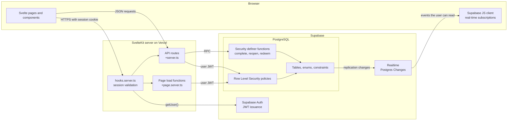
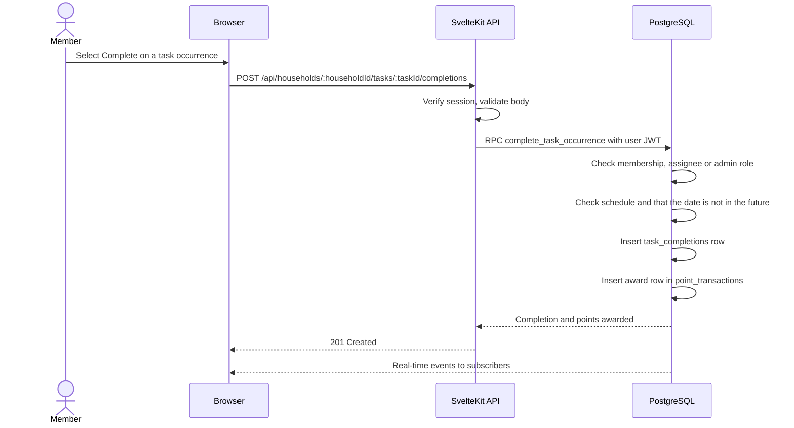

# HomeBase System Architecture

> **Status: partially implemented.** The frontend (route groups, application shell, pages, and public sign-in pages) is built on typed sample data. The backend (authentication, database, API routes, and real-time synchronization) is planned.

## 1. Overview

HomeBase is a full-stack SvelteKit application. The browser renders pages and sends requests to SvelteKit. SvelteKit verifies the user's Supabase session and sends data requests to Supabase PostgreSQL using that user's JWT. PostgreSQL Row Level Security (RLS) decides which rows the user can read or change. Supabase Realtime pushes row changes to subscribed browsers.

Three principles shape the design:

1. **Household isolation.** Every household-owned row stores a `household_id`, and every access rule checks membership in that household.
2. **Server-side authority.** Changes go through SvelteKit API routes, which validate input and check roles before touching the database. RLS is the final check, not the only one.
3. **Database-enforced integrity.** Point awards, completions, reversals, and invitation redemption run as database functions and use constraints, so race conditions cannot create duplicate awards or duplicate memberships.

## 2. Components

The table shows the current state of each component. The frontend is built and uses sample data. The backend is planned.

| Component         | Responsibility                                                                    | Technology                           | Status                                                                   |
| ----------------- | --------------------------------------------------------------------------------- | ------------------------------------ | ------------------------------------------------------------------------ |
| Browser UI        | Pages, forms, dashboard, and navigation                                           | Svelte 5, Tailwind CSS, Lucide icons | Implemented on typed sample data                                         |
| Real-time client  | Subscriptions to shared tables                                                    | Supabase JS client                   | Planned                                                                  |
| SvelteKit server  | Session handling, page `load` functions, JSON API routes, validation, role checks | SvelteKit 3, TypeScript              | Route groups and layouts exist. No API routes, hooks, or data access yet |
| Hosting           | Runs the SvelteKit server as Vercel functions                                     | Vercel, `@sveltejs/adapter-vercel`   | Adapter installed and building; not deployed                             |
| Supabase Auth     | Account creation, login, sessions, and JWT issuance                               | Supabase Auth                        | Planned. The placeholder provider in `src/lib/auth/` stands in for it    |
| PostgreSQL        | System of record, constraints, and business functions                             | Supabase PostgreSQL                  | Planned                                                                  |
| RLS policies      | Row-level access rules for every exposed table                                    | PostgreSQL policies                  | Planned                                                                  |
| Supabase Realtime | Broadcasts row changes that the subscriber is allowed to read                     | Supabase Realtime (Postgres Changes) | Planned                                                                  |

### 2.1 Frontend route structure

SvelteKit route groups organize the frontend without changing its URLs. A group name in parentheses does not appear in the path.

| Route group | Layout                                                                    | URLs                                                                                                     |
| ----------- | ------------------------------------------------------------------------- | -------------------------------------------------------------------------------------------------------- |
| _(none)_    | `src/routes/+layout.svelte`: global stylesheet and favicon only           | Applies to every page                                                                                    |
| `(app)`     | `(app)/+layout.svelte`: sidebar shell, with sample data from `+layout.ts` | `/dashboard`, `/tasks`, `/groceries`, `/calendar`, `/expenses`, `/leaderboard`, `/household`, `/profile` |
| `(auth)`    | `(auth)/+layout.svelte`: centered public layout, without the sidebar      | `/login`, `/register`, `/forgot-password`                                                                |

`src/routes/+page.ts` redirects `/` to `/dashboard`.

Typed links use route IDs, which include the group segment. For example, `resolve('/(app)/tasks')` produces `/tasks`. The types for these IDs live in `src/lib/routes.ts`, where `AppRoute` and `AuthRoute` are defined. `publicPathname()` converts a route ID into its public URL. The navigation tests check that every public URL is unchanged.

### 2.2 Authentication seam (prepared, not implemented)

The frontend is ready for Supabase Auth without depending on it.

| Module                       | Purpose                                                                                                                                                                           |
| ---------------------------- | --------------------------------------------------------------------------------------------------------------------------------------------------------------------------------- |
| `src/lib/auth/types.ts`      | `AuthUser`, `Profile`, `AuthResult`, the sign-in and registration inputs, and the `AuthProvider` interface                                                                        |
| `src/lib/auth/validation.ts` | Client-side validation for email, passwords, confirmation, and names. These checks shape messages and are not authorization                                                       |
| `src/lib/auth/messages.ts`   | Wording for each result. Messages state what did not happen, and never claim that an account was created or an email sent                                                         |
| `src/lib/auth/provider.ts`   | `placeholderAuthProvider`, the only implementation today. It returns `not-connected` for every action and never reports a signed-in user                                          |
| `src/lib/components/auth/`   | The sign-in, registration, and password-reset forms and their card. Each form accepts a `provider` prop, so the Supabase implementation can be injected without changing the form |

The placeholder stores no passwords, creates no sessions, and makes no network calls. The `(app)` pages are reachable without signing in, because the preview has no authorization yet. The planned server-side checks are described in sections 5 and 6.

### 2.3 Current frontend behavior

- All data comes from typed sample data in `src/lib/mock/`. Nothing is saved, and reloading the page restores the sample data.
- Forms and toggles change only the screen they are on. Each form says that its change is not saved.
- The household switcher changes the household name in the header. The pages keep showing the sample household.
- Sign-out and password changes are shown as disabled controls, with a note that sign-in is not connected.

## 3. Architecture diagram

Two paths reach the database. Ordinary reads run through page loads or direct queries and rely on RLS. Writes that need business rules, such as completing a task or redeeming an invitation, go through API routes and then into database functions. The browser never receives a service-role key.

## 4. Request flows

### 4.1 Server-rendered page load

1. The browser requests a protected page with its Supabase session cookies.
2. `hooks.server.ts` (planned) creates a Supabase server client from the request cookies.
3. The hook verifies the user with `supabase.auth.getUser()`. It does not trust `getSession()` alone, because that reads cookie contents without contacting Supabase Auth.
4. If there is no valid user, the request redirects to the login page.
5. The page's `load` function queries the database as the user. RLS limits the rows returned.
6. The page renders with the data it received, or with an empty or error state.

### 4.2 Mutation through an API route

1. The client sends a JSON request to a route under `/api`.
2. The handler checks the session (401 if missing), parses and validates the body (400 if invalid), and checks the caller's household role (403 if insufficient).
3. The handler performs a table write or calls a database function with the user's JWT.
4. RLS evaluates the statement. A denied write returns 403. A row the user cannot see returns 404.
5. The handler returns the documented response shape. See [api.md](api.md).

### 4.3 Task completion

The completion row and the award row are written in one transaction. If either write fails, neither is kept. The detailed rules are in [database.md](database.md#7-atomic-point-transactions).

### 4.4 Real-time updates

1. After login, the client subscribes to the tables it displays, filtered by `household_id`. The filter is a convenience. RLS is what enforces access.
2. When a row changes, Realtime checks it against the subscriber's RLS policies before sending it.
3. The client updates the matching part of the UI in place.
4. By default, `DELETE` events include only the primary key, so the client refetches the affected list instead of relying on the deleted row's contents.

Tables published for real-time updates are `tasks`, `task_completions`, `point_transactions`, `grocery_lists`, `grocery_items`, and `calendar_events`.

### 4.5 Invitation redemption

1. The user submits a code to `POST /api/invitations/redeem`.
2. The server normalizes the code (uppercase, without separators) and computes its HMAC-SHA-256 with a server-only secret.
3. The server calls the `redeem_invitation` function with the hash. The plaintext code never reaches the database.
4. The function locks the matching invitation row, checks that it is not revoked, not expired, and not used up, then adds the caller as a `member` and increments `use_count`. All of this happens in one transaction.
5. The response returns the household. Invalid codes return one generic error, so a caller cannot tell an expired code from an unknown one.

## 5. Security boundaries

| Boundary                              | Trust level                | Controls                                                                                                                                                                                                                                          |
| ------------------------------------- | -------------------------- | ------------------------------------------------------------------------------------------------------------------------------------------------------------------------------------------------------------------------------------------------- |
| Browser and SvelteKit server          | Untrusted client           | HTTPS only. Session cookies are `HttpOnly`, `Secure`, and `SameSite=Lax` (planned). API bodies must be `application/json`, which forces a CORS preflight for cross-origin calls. Input validation on every route.                                 |
| SvelteKit server and Supabase Auth    | Verified session           | `getUser()` on each protected request. Token refresh handled by the Supabase SSR helper.                                                                                                                                                          |
| SvelteKit server and PostgreSQL       | Authenticated user context | Requests carry the user's JWT, so PostgreSQL applies the `authenticated` role and RLS. Tables have no grants that bypass RLS.                                                                                                                     |
| Client code and secrets               | Public                     | Only variables prefixed `PUBLIC_` reach the browser. The anon key is public by design because RLS protects the data. The service-role key and invitation HMAC secret are server-only. SvelteKit blocks imports of `$lib/server` from client code. |
| Security definer functions and tables | Privileged                 | Each function checks `auth.uid()` and household membership itself, sets `search_path = ''`, and is executable only by `authenticated`.                                                                                                            |
| Realtime and subscribers              | Untrusted                  | Subscribers receive only rows that their RLS SELECT policies allow. This must be verified during implementation.                                                                                                                                  |

The service-role key bypasses RLS. It must never appear in client code, `PUBLIC_` variables, or logs. The request path does not need it. See [setup.md](setup.md#7-environment-variables).

## 6. Role permissions

HomeBase has two household roles, `admin` and `member`. A user who is not a member of a household has no access to that household's data.

| Capability                                                                         | Admin                  | Member                           | Non-member |
| ---------------------------------------------------------------------------------- | ---------------------- | -------------------------------- | ---------- |
| View household details, members, tasks, groceries, calendar, expenses, leaderboard | Yes                    | Yes                              | No (404)   |
| Rename household, change time zone or currency                                     | Yes                    | No                               | No         |
| Create and revoke invitation codes                                                 | Yes                    | No                               | No         |
| Change a member's role                                                             | Yes                    | No                               | No         |
| Remove a member                                                                    | Yes                    | No                               | No         |
| Leave a household                                                                  | Yes, unless last admin | Yes                              | No         |
| Create, edit, assign, set points for, and archive tasks                            | Yes                    | No                               | No         |
| Complete or reopen a task occurrence                                               | Yes, any task          | Yes, only tasks assigned to self | No         |
| Create, edit, and delete grocery lists and items                                   | Yes                    | Yes                              | No         |
| Create calendar events and expenses                                                | Yes                    | Yes                              | No         |
| Edit or delete a calendar event or expense                                         | Yes, any               | Yes, own only                    | No         |

Rules that apply across the table:

- A non-member gets **404** for any household resource, so the API does not reveal whether a household exists.
- A member who lacks the required role gets **403**.
- Task fields that affect points (`pointsValue`, `assigneeId`, and `recurrence`) are admin-only. Members cannot raise their own points.
- Points are awarded only to the assignee, never to whoever clicked Complete. See [ADR 003](adrs/003-points-and-invitations.md).

## 7. Error handling

Errors are handled in layers. Each layer returns the same JSON error envelope described in [api.md](api.md#3-error-format).

| Layer                         | Failure                                          | HTTP | Code                                         |
| ----------------------------- | ------------------------------------------------ | ---- | -------------------------------------------- |
| Session check                 | No valid session                                 | 401  | `UNAUTHENTICATED`                            |
| Input validation              | Missing or malformed field                       | 400  | `VALIDATION_FAILED`                          |
| Route role check              | Member calls an admin-only route                 | 403  | `FORBIDDEN`                                  |
| Membership or RLS             | Non-member, or row hidden by RLS                 | 404  | `NOT_FOUND`                                  |
| Database function rule        | Occurrence not scheduled, or after today         | 422  | `INVALID_OCCURRENCE`, `OCCURRENCE_IN_FUTURE` |
| Database unique constraint    | Second active completion for an occurrence       | 409  | `ALREADY_COMPLETED`                          |
| Database function state check | Reopen a completion that is not active           | 409  | `NOT_COMPLETED`                              |
| Database function rule        | Would remove the last admin                      | 409  | `LAST_ADMIN_REQUIRED`                        |
| RLS insert or update denial   | Write not allowed for this role (SQLSTATE 42501) | 403  | `FORBIDDEN`                                  |
| Rate limiting                 | Too many requests                                | 429  | `RATE_LIMITED`                               |
| Anything unexpected           | Unhandled exception                              | 500  | `INTERNAL_ERROR`                             |

Implementation rules:

- Validation runs in the route before any database call, so most bad input never reaches PostgreSQL.
- Database errors are translated by SQLSTATE and by custom error codes raised inside functions. Raw SQL messages are never returned to the client.
- The `handleError` hook (planned) logs unexpected errors on the server with a request ID and returns a generic `INTERNAL_ERROR` response. Stack traces and SQL text are not sent to the browser.
- Page `load` functions use `error()` from `@sveltejs/kit` for not-found and forbidden states, so the error page shows the correct status.
- Every list view in the UI needs loading, empty, success, and error states. Errors show a message and a retry action, not a blank screen.

## 8. Known limitations

- **No authentication yet.** The sign-in, registration, and password-reset pages validate their input but do not check credentials, create accounts, or send email. The `(app)` pages are reachable without signing in.
- **No persistence.** All data is sample data in `src/lib/mock/`. Changes made in a form or toggle last only until the page is reloaded.
- **No real-time synchronization.** The interface does not receive updates from other users.
- **One Supabase project per environment.** Development, preview, and production each need their own project. Data is not shared between them.
- **Real-time is an addition to server loads, not a replacement.** Clients refetch after reconnecting to avoid missing events.
- **Recurrence is intentionally simple.** Only daily, weekly, and monthly schedules are supported, without custom intervals. See [database.md](database.md#8-recurring-task-occurrences).
- **Single currency per household**, and time zones are stored per household rather than per user.
- **No offline mode, email notifications, or push notifications** in the first version.
- **Trust within a household.** Points rely on the honesty of household members. The safeguards in [ADR 003](adrs/003-points-and-invitations.md) prevent accidental and casual abuse, not determined fraud by an admin.
